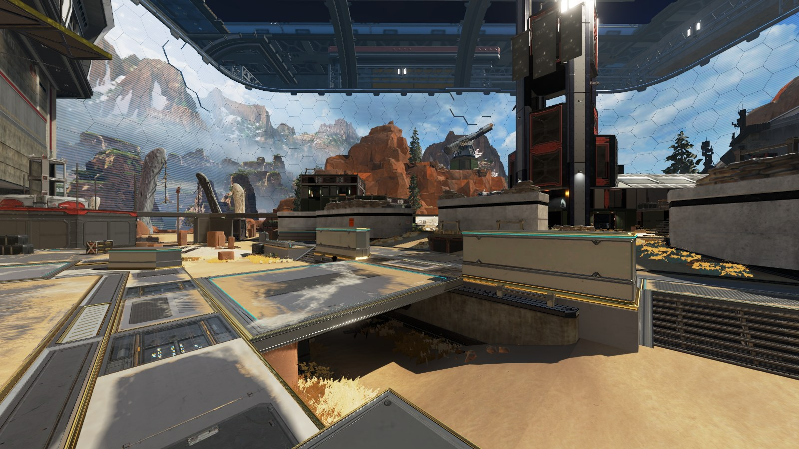
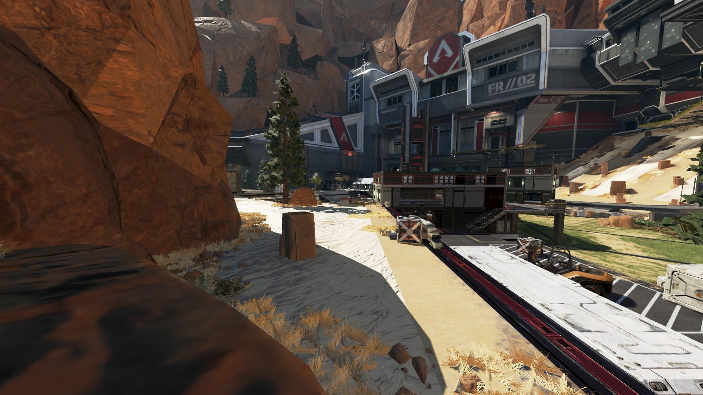
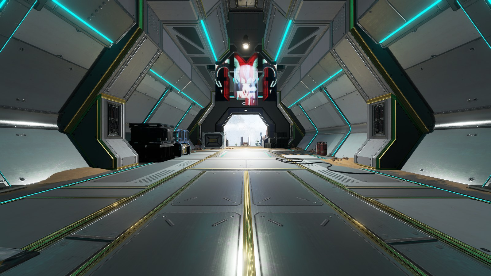

# R5Rust

> Part of the [R5Rust](https://github.com/R5Rust) org. Clone the repos side by side:
> **R5Rust** (this: client, server, shared sim), **[export-map](https://github.com/R5Rust/export-map)** (builds the map data
> from your own Apex install), **[r5f-probe](https://github.com/R5Rust/r5f-probe)** (ground truth from real R5Flowstate).
> No game assets live in any of them: you extract them from your own install.



| | |
|---|---|
|  |  |

From-scratch Rust engine that loads the Apex Legends **Firing Range** (`mp_rr_canyonlands_staging_mu1`) from
your own extracted assets, and lets you walk around it. Long-term goal: client `r5rust` + headless dedicated
server `r5rust_ds`, like R5Flowstate's `r5apex.exe` / `r5apex_ds.exe`.

## Play (while code keeps changing)

Double-click **`play.bat`** (or `.\play.ps1`). It runs your own copy in `play\current\`, so builds never
fight with an open game. `tools\publish.ps1` builds and stages a new version in `play\next\`; the next time
you launch `play.bat` it swaps in automatically and prints what it updated to. `play\` is gitignored.

## Run (dev)

```powershell
cargo run --release --bin r5rust
```

Shows the real loading screen, loads the map (~8 s cold, ~1.5 s warm), and drops you at the real spawn.

Controls are rebindable: **Esc opens Settings** (two binds per action, like Apex; click a slot and press a key,
mouse button or wheel; right-click clears). Sensitivity (Apex units), FOV and invert are on the Mouse & View tab.
Everything saves to `r5rust_settings.toml` (gitignored). Defaults:

| Action | Binds |
|---|---|
| Move | W / A / S / D |
| Jump | SPACE, MWHEELDOWN (superglides, bhops) |
| Crouch (hold) / slide | LCTRL, C |
| Sprint | LSHIFT (one tap latches it while you keep moving forward) |
| Fly toggle / fly down | V / X |
| Respawn | R |
| Fullscreen | F11 |
| Settings menu | Esc (Resume / Quit in the menu) |

Movement is Apex's own (ported from R5Regenis' disassembly specs + the game's pilot settings): walk 173.5, sprint 260,
crouch 80, slide + boost, slide jump, bhop rules, tap strafe, step 22, mantle + superglide + **mantle boost**,
**wall climb** + jump off the wall.
See `docs/movement.md`; `cargo run --release -p shared --example movecheck` runs its 130 checks.

The window title shows fps, position and ground/air/FLY.

## Game data (not in the repo, never commit it)

Default root `D:\R5Rust\assets` (override with `R5RUST_ASSETS` or `assets_root` in `r5rust.toml`):

- `maps\mp_rr_canyonlands_staging_mu1\world.glb` + `meta.json`, made by `[export-map](https://github.com/R5Rust/export-map)`
- `maps\mp_rr_canyonlands_staging_mu1\collision.bin`: the game's own collision, made by `export-map --collision`
  (see `docs/collision.md`). Without it the player collides with the render triangles and the log warns.
- `images\ui\maps_mp_rr_canyonlands_staging_mu1_loadscreen\*.png`

## Config: `r5rust.toml` (optional, gitignored)

Put it in the repo root or next to the exe. All keys are optional:

```toml
width = 1600
height = 900
fullscreen = false
vsync = false
sensitivity = 1.6     # Apex/Source scale (m_yaw 0.022)
fov = 100             # horizontal at 4:3, like Apex
fly_speed = 1200
backend = "vulkan"    # vulkan | dx12 | gl (falls back through the others)
max_texture_size = 1024
```

## Screenshot / test mode (no window)

```powershell
.\target\release\r5rust.exe --screenshot out.png [--loadshot load.png] [--frames 120]
    [--pos x,y,z] [--yaw deg] [--pitch deg] [--hold w,shift,space] [--fly] [--debug 1|2|3]
    [--expo-curve x,y,z,pitch,yaw]
```

Settles for 30 ticks, holds `--hold` keys for `--frames` ticks (60/s), renders, and prints load stats,
GPU ms/frame, where the player ended up and the jump peak. `--debug`: 1 = sun visibility (lightmap A),
2 = baked indirect light, 3 = albedo only.
`--expo-curve` then cuts the camera between `--pos` and that second pose (feet position) both ways and prints the
auto exposure after every frame, the frames to 50/90/99 %, and the gap to the engine formula run on the CPU.
Dark rock crevice to bright road: `--pos 1800,-5200,500.8 --pitch 5 --yaw 202.5 --expo-curve -3000,-200,-82.9,5,67.5`.

## Re-exporting the map

`export-map` (Rust, standalone) rebuilds `world.glb` + `meta.json` from the game's paks; `export-map/build_materials.py`
maps materials to the extracted textures + constants (`materials.json`). Lighting lumps live in `<map>/bsp/`,
cubemaps in `cubemaps.dds`, the dome's sky cubes in `skies\<material>.dds` (fallback `skycube.dds`). Compressed texture
cache: `D:\R5Rust\_cache\tex`. Run `python ..\export-map\build_materials.py` after every full export (new skins bring new materials).

Full export (~2 min; the exporter's `../../../../apex` path dependencies only resolve from the main checkout, not a worktree):
`cd ..\export-map; cargo run --release -- --out D:\R5Rust\assets\maps\mp_rr_canyonlands_staging_mu1`. It applies each static
prop's skin, and tags geometry in the glb material extras: `noShadow` (prop flag 0x10, decal meshes: never in the shadow
cascades, `docs/apex-lighting.md`) and `skybox` (prop flag 0x40: drawn only from the sky camera, `docs/skybox.md`).
Older world.glb files without those extras still load. The previous export is kept as `world.v1.glb` / `meta.v1.json`.

Collision only (about 20 s, reuses the last export's BSP + models):
`cd ..\export-map; cargo run --release -- --collision --out D:\R5Rust\assets\maps\mp_rr_canyonlands_staging_mu1`.
Compare it with the render triangles: `cargo run --release -p shared --example collcompare`; inspect one spot:
`--example collprobe -- x,y [zmin zmax] [radius]`.

## Layout

- `crates/shared`: GLB loader, the game's collision (`collmesh.rs` loads `collision.bin`), BVH collision with an Apex-style hull sweep (`trace_hull`), deterministic
  `sim::simulate()` = Apex S21 movement ported from the R5Regenis specs (`docs/movement.md`), player settings + cvars
  (`settings.rs`), config. Checker: `cargo run --release -p shared --example movecheck`
- `crates/client`: `r5rust`: wgpu renderer (4x MSAA HDR, reverse-Z, lightmaps + sun, ACES), loader thread, input
- `crates/server`: `r5rust_ds`, a stub for now

## Status (2026-11-16)

v1 works: load screen, Firing Range with baked lighting at ~340-600 fps on a 2080 Ti, fly with collision, and Apex's
real movement (walk/sprint/crouch/slide/jump/air strafe/tap-strafe/step/mantle/mantle boost/wall climb; ~50 us per tick, see
`docs/movement.md`). See `HANDOFF.md` for what's next.

Not done: dedicated server + netcode + prediction (v2), shadows on unlightmapped props (big rocks, some props),
interior lights (the bake has none, so interiors use a flat fill), dynamic props, HUD, weapons, audio, the 3D skybox's
own fog (and its vista brightness is unverified; `docs/skybox.md`).

2026-11-16: no-shadow props/decals stay out of the cascades (the range road under the giant gaskets is sunlit again),
static prop skins are applied (the dome shows the Firing Range sea and mountains instead of Skull Town), and the 3D
skybox draws from the sky camera like the S21 client (`docs/skybox.md`).
